# Introdução

Informações básicas do projeto.

- **Projeto:** PoupaAí
- **Repositório GitHub:** https://github.com/ICEI-PUC-Minas-PPLES-TI/plf-es-2025-2-ti1-5567100-precos_mercado.git
- **Membros da equipe:**

  - [Bernardo Duarte Medeiros de Paula](https://github.com/bernardodvarte)
  - [Bruna Pedrosa Nunes](https://github.com/brunapedrosabr)
  - [Lucas Gonçalves Sivolella](https://github.com/lsivolella)
  - [Plínio Ângelo Ferreira](https://github.com/afplinio)
  - [Sofia Ferreira Costa](https://github.com/costa-sofia)
  - [Vinicius Ramos Sales](https://github.com/ViniRSales)

A documentação do projeto é estruturada da seguinte forma:

1. Introdução
2. [Contexto](#contexto)
3. [Product Discovery](#product-discovery)
4. [Product Design](#product-design)
5. [Metodologia](#metodologia)
6. [Solução](#solução-implementada)
7. [Referências Bibliográficas](#referências)

✅ [Documentação de Design Thinking (MIRO)](files/Design%20Thinking.pdf)

# Contexto

Detalhes sobre o espaço de problema, os objetivos do projeto, sua justificativa e público-alvo.

## Problema

O cenário atual de compras em supermercados no Brasil apresenta alguns desafios para os consumidores como:

**1. Falta de centralização das Informações**

- Os consumidores precisam consumir múltiplas fontes de informação para comparar preços como sites dos supermercados, aplicativos, folhetos promocionais dos supermercados e/ou anúncios.
- As informações sobre promoções são dispersas e difíceis de encontrar.
- Não é mantido um histórico de compras para o consumidor poder replicar e/ou consultar a fim de otimizar suas compras.

**2. Ineficiência no Planejamento**

- Segundo pesquisa feita pela Neogrid e Opinion Box de 2024, 40% dos brasileiros fazem múltiplicas compras no mês o que pode estar ligado por falta de planejamento ou por preferência do consumidor em dividir por partes.
- As listas de compras são regularmente esquecidas ou incompletas pelos consumidores.
- Não há sugestão ao consumidor baseado em consumo anterior.

**3. Perda de Oportunidade Econômica**

- Segundo pesquisa feita pela Neogrid e Opinion Box de 2024, 85% dos brasileiros compram além do planejado quando encontram produtos com preços mais baixos.
- As promoções são frequentemente descobertas no momento da compra.
- Há carência e falta de alertas personalizados sobre ofertas relevantes para o consumidor específico.

Esse problema se manifesta em um mercado onde 90% dos brasileiros buscam constantemente economia, mas carecem de ferramentas tecnológicas integradas para otimizar suas decisões de compra.

## Objetivos

**Objetivo Geral:** Desenvolver uma aplicação mobile que centralize e otimize a experiência de compras em supermercado, oferecendo comparação de preços, gestão inteligente de listas, alertas personalizados de ofertas e promoções além da visualização no mapa de locais com melhores preços para consumidores brasileiros.

**Objetivos Específicos:**

- Implementar um sistema de comparação de preços
- Criar funcionalidade da gestão inteligente da lista de compras podendo salvar, criar ou editar
- Estabelecer sistema de alertas personalizados para promoções relevantes baseadas nas preferências do usuário

## Justificativa

O desenvolvimento dessa aplicação web se baseia principalmente em três tópicos que são:

**1. Relevância Econômica**

-	17,5% das despesas familiares brasileiras são com alimentação.
-	Supermercados representam 9,1% da receita do comércio nacional.
-	87% dos consumidores buscam opções mais baratas.
-	Crescimento de 4% no consumo em 2025.
-	Compras de supermercado são a principal fonte de endividamento no cartão de crédito (dados Serasa) representando 59%.

**2. Oportunidade Tecnológica**

- 71% dos brasileiros mudaram hábitos de compra no últino ano.
- 30% dos brasileiros pesquisam preços antes de ir ao supermercado.
- 85% dos brasileiros compram além do planejado quando encontram ofertas.
- Há falta de soluções integradas no mercado brasileiro.

**3. Experiência do Consumidor**

- Consumidores buscam praticidade, saúde e escolhas conscientes.

## Público-Alvo

O público alvo do projeto, mesmo que seja uma aplicação que possa servir para toda a sociedade, pode ser definido a partir dos apontamentos descritos abaixo.

- Consumidores em geral que buscam economizar em suas compras, principalmente em produtos de uso cotidiano (alimentos, eletrônicos, medicamentos, etc.).

- Adultos jovens a de meia-idade (18 a 50 anos), que já utilizam aplicativos com frequência para compras online e estão familiarizados com tecnologia.

- Famílias e responsáveis pelas compras domésticas, que procuram os melhores preços para otimizar o orçamento mensal.

- Usuários com renda média que têm mais sensibilidade a variações de preço e, portanto, tendem a buscar alternativas mais baratas.

Em resumo, consumidores preocupados em obter o melhor custo-benefício em suas compras. Como citado anteriormente, embora o sistema possa ser utilizado por qualquer pessoa, ele se destina especialmente a indivíduos entre 18 e 50 anos, familiarizados com tecnologia e que buscam praticidade na comparação de preços. Famílias e responsáveis pelas compras domésticas são também um segmento importante, pois tendem a utilizar a ferramenta para otimizar seus gastos e tempo. Além disso, e também podendo estar atrelado aos outros grupos citados previamente, pessoas com uma renda média ou menor também são essenciais, pois preferencialmente buscarão os produtos com os preços mais em conta.

# Product Discovery

## Etapa de Entendimento

### Matriz CSD


### Mapa de Stakeholders


### Entrevistas Qualitativas


### Highlights de Pesquisa


## Etapa de Definição

### Personas

Persona 1: Osvaldo


Persona 2: Pedro


Persona 3: Carla


# Product Design

Nesse momento, vamos transformar os insights e validações obtidos em soluções tangíveis e utilizáveis. Essa fase envolve a definição de uma proposta de valor, detalhando a prioridade de cada ideia e a consequente criação de wireframes, mockups e protótipos de alta fidelidade, que detalham a interface e a experiência do usuário.

## Histórias de Usuários

Com base na análise das personas foram identificadas as seguintes histórias de usuários:

| ID   | EU COMO...`PERSONA`                | QUERO/PRECISO ...`FUNCIONALIDADE`                                           | PARA ...`MOTIVO/VALOR`                                                                   |
| ---- | ---------------------------------- | --------------------------------------------------------------------------- | ---------------------------------------------------------------------------------------- |
| US01 | Osvaldo                            | Um histórico com os preços dos produtos que costumo consumir                | Evitar lojas que tenham aumentado os preços repentinamente e buscar produtos substitutos |
| US02 | Pedro                              | Encontrar os melhores preços para os produtos                               | Ter mais dinheiro para sair com os amigos                                                |
| US03 | Carla                              | Saber onde posso encontrar os produtos que preciso comprar                  | Ter mais tempo para realizar minhas tarefas e descansar em casa                          |
| US04 | Consumidor geral                   | Um aplicativo que me ajude a descobrir o preço dos produtos de supermercado | Que eu possa comparar preços e assim economizar em minhas compras                        |
| US05 | Dono de restaurante                | Saber o local onde encontro todos produtos que preciso                      | Comprar os ingredientes necessários para cozinhar todos os alimentos do cardápio         |
| US06 | Membro de uma grande família       | Comprar uma grande quantidade de itens no supermercado                      | Atender toda a demanda familiar e manter a qualidade do lar                              |
| US07 | Atleta                             | Encontrar produtos específicos com facilidade                               | Atender minha dieta restrita                                                             |
| US08 | Consumidor com mobilidade reduzida | Consumidor com mobilidade reduzida                                          | Que eu consiga fazer minhas compras sem maiores complicações                             |
| US09 | Empresária                         | Otimizar meu tempo com idas as supermercado                                 | Conciliar meu trabalho com as compras de casa para mim e para minha família              |

## Proposta de Valor

##### Proposta para Persona 1: Osvaldo


##### Proposta para Persona 2: Pedro


##### Proposta para Persona 3: Carla


## Projeto de Interface

Artefatos relacionados com a interface e a interacão do usuário na proposta de solução.

### Wireframes

Estes são os protótipos de telas do sistema.

##### Tela de Login

Criamos uma tela de login com possibilidade de se ter uma conta pela própria conta Apple, pelo Gmail ou por um cadastro próprio do site com qualquer tipo de e-mail. Você também pode, caso tenha esquecido a sua senha, clicar no botão "Esqueceu a Senha?", onde será redirecionado para outra tela para resolução do problema.


##### Tela de Cadastro

Nossa tela de cadastros pede informações básicas como o e-mail do usuário, seu nome, telefone e CPF. Além disso, obviamente, também é solicitado a criação de uma senha, além da confirmação da mesma.


##### Esqueceu a Senha (1/3)

Esta é a primeira tela que se apresenta ao clicar que esqueceu sua senha. Neste momento, você deve colocar seu e-mail ou telefone para recuperação.


##### Esqueceu a Senha (2/3)

Após preencher na tela anterior com e-mail ou telefone, o site te mostrará um campo para preencher com um token que é enviado na opção escolhida anteriormente.


##### Esqueceu a Senha (3/3)

Por fim, você redefine a sua senha informando-a em ambos os campos, sendo um deles para reconfirmação da mesma.


##### Tela Inicial

Ao logar e acessar a home, você se deparará com uma tela com uma versão reduzida do mapa de mercados, além de ter a possibilidade de acessar seu histórico de listas ou abrir uma nova. Você também é capaz de fazer uma busca por um item em específico nesta tela.


##### Lista de Compras

Selecionando seus produtos, o aplicativo te levará para sua lista de compras, onde você poderá adicionar mais produtos, finalizar a lista ou editar os itens já incluídos.


##### Adicionar Produto

Esta tela serve para adicionar produtos na sua lista de compras. Há filtros de nome, marca e descrição. Também há um campo de quantidade para adicionar mais de um de uma vez caso queira.


##### Histórico de Listas

Nesta tela você consegue acessar o histórico de todas as suas listas já feitas, contando com valores totais, quantidade de produtos, além de ser possível detalhar.


##### Resumo

Esta é a tela detalhada da sua lista selecionada no histórico. Todos os produtos e seus preços ficam armazenados nela.


##### Mapa de Mercados

Esta é a tela expandida do mapa de mercados mencionado anteriormente. Através dela você consegue visualizar quais supermercados estão mais perto da sua localidade e traçar um caminho até o escolhido.


##### Comparação de Preços

A partir dessa funcionalidade é possível comparar preços de produtos iguais em diferentes supermercados.


##### Filtragem

Na busca por produtos, o site te permite fazer filtros (supermercados, marcas, etc.) para encontrar mais facilmente.


### User Flow


### Protótipo Interativo

Nosso protótipo interativo foi feito através do próprio Figma, basta clicar no link abaixo.

✅ [Protótipo Interativo](https://www.figma.com/proto/LlSi6oktUlezQnomFvF1KN/Pre%C3%A7os-Mercado?node-id=85-132&p=f&t=KJUl4L2lWBopU280-1&scaling=min-zoom&content-scaling=fixed&page-id=0%3A1&starting-point-node-id=85%3A132&show-proto-sidebar=1)

# Metodologia

Detalhes sobre a organização do grupo e o ferramental empregado.

## Ferramentas

Relação de ferramentas empregadas pelo grupo durante o projeto.

| Ambiente                    | Plataforma         | Link de acesso                                                                                               |
| --------------------------- | ------------------ | ------------------------------------------------------------------------------------------------------------ |
| Processo de Design Thinking | Miro               | https://miro.com/app/board/uXjVJRfmPqM=/                                                                     |
| Comunicação                 | Google Meet        | https://meet.google.com/                                                                                     |
| Comunicação                 | Whatsapp        | https://web.whatsapp.com/                                                                                     |
| Repositório de código       | GitHub             | https://github.com/ICEI-PUC-Minas-PPLES-TI/plf-es-2025-2-ti1-5567100-precos_mercado.git                      |
| Editor de código            | Visual Studio Code | https://code.visualstudio.com/                                                                               |
| Protótipo Interativo        | Figma              | https://www.figma.com/design/LlSi6oktUlezQnomFvF1KN/Pre%C3%A7os-Mercado?node-id=0-1&p=f&t=DBwjVbY4Q0JGavk3-0 |

## Gerenciamento do Projeto

Divisão de papéis no grupo e apresentação da estrutura da ferramenta de controle de tarefas.

O grupo se organizou para a realização do trabalho adotando a metodologia Scrum, em que, antes de cada uma das três sprints, foi realizada uma reunião de planejamento utilizando o Google Meet, mantendo também a comunicação no meio e no fim das sprints para alinhamento e conformidade do projeto. Todos atuaram no levantamento e organização de requisitos e também como desenvolvedores, de forma autogerenciável.

Cada integrante se organizou para realizar seu próprio controle de tarefas (em tarefas individuais) e, nas tarefas que dependiam de mais membros, o controle foi feito por mensagens em um grupo no WhatsApp.

A gestão de configuração do projeto via GitHub foi feita hora diretamente na master, hora em branches separadas, para posterior merge na master. Assim respeitando o controle de versão e permitindo que os integrantes trabalhassem de maneira simultânea.


# Solução Implementada

Esta seção apresenta todos os detalhes da solução criada no projeto.

## Vídeo do Projeto

[](https://drive.google.com/drive/folders/1XkgxoucpymJEWLwxKCIejxOsUYNHfwOI?usp=sharing )

## Funcionalidades

Esta seção apresenta as funcionalidades da solução

##### Funcionalidade 1 - Cadastro de usuário e login

Permite o cadastro de novo usuário para o sistema, e caso ja seja cadastrado, permite fazer o login

- **Instruções de acesso:**
  - Abra o site e no canto superior direito, clique em entrar
  - Caso não seja cadastrado, clique em "Cadastre-se"
  - Em seguida, efetue o login
- **Tela da funcionalidade**:

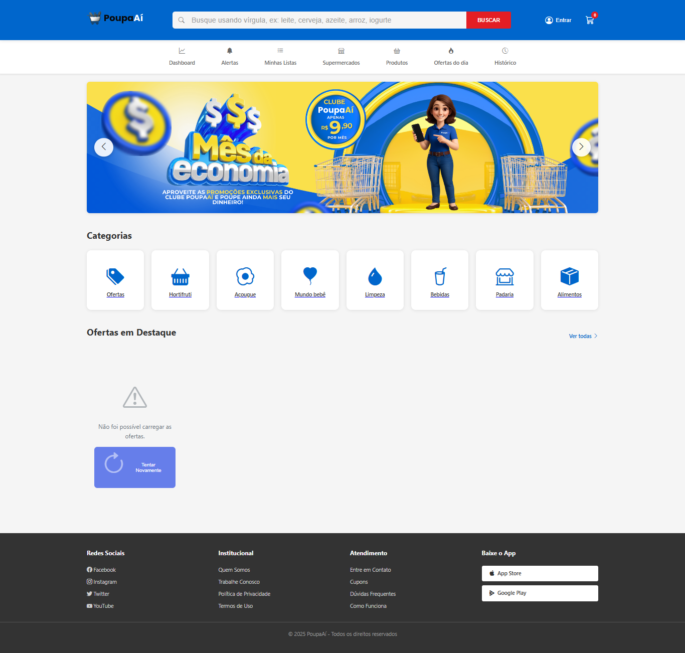

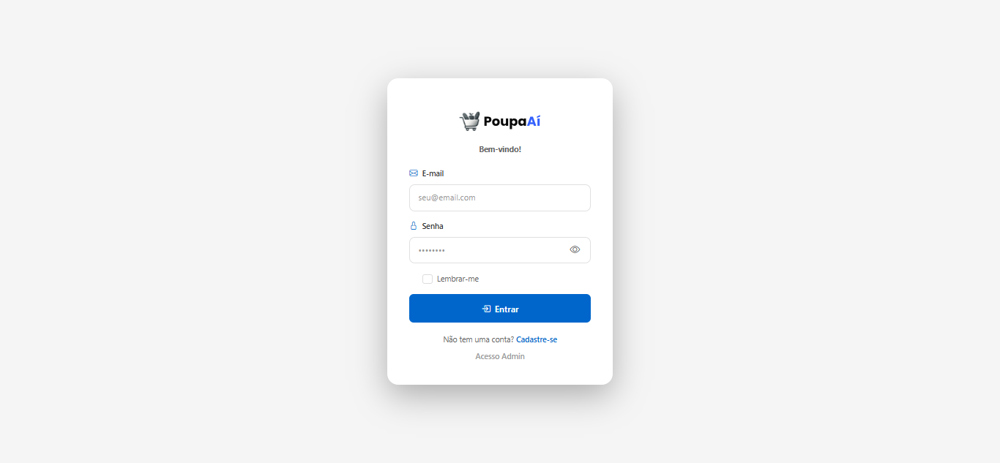

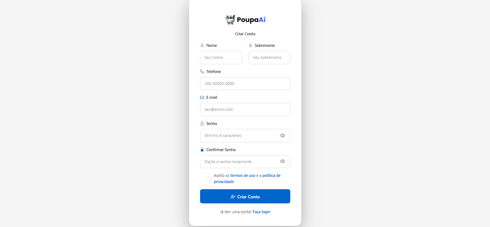

- **Estrutura de dados:**

Usuário

```json
    {
      "id": 1,
      "nome": "Sofia Almeida",
      "sobrenome": "Santos",
      "telefone": "(31) 98765-4321",
      "email": "sofia@example.com",
      "senha": "@senha123",
      "avatar": "../assets/img/avatar-default.svg",
      "dataCadastro": "2024-01-15T10:30:00",
      "endereco": {
        "cep": "33400-000",
        "rua": "Rua das Flores",
        "numero": "123",
        "bairro": "Centro",
        "cidade": "Lagoa Santa",
        "estado": "MG"
      }
    }
```

##### Funcionalidade 2 - Tela inicial para ter acesso a promoções e carrinho de compras

Permite que o usuário veja os produtos que estão disponíveis e se desejar, adicionar esses produtos em seu carrinho de compras, onde pode visualizar produto, preço e supermecado do produto adicionado, editar a quantidade e a forma de pagamento, e registrar sua compra.

- **Instruções de acesso:**
  - Na tela inicial, role para baixo para ver os produtos em destaque
  - Se desejar, adicione algum deles ao carrinho
  - Ainda na tela inicial, clique na imagem do carrinho, no canto superior direito
  - No carrinho, clique em "+" se desejar aumentar a quantidade do produto
  - Clique em "-" se desejar diminuir a quantidade do produto
  - Ou clique na imagem da lixeira se desejar excluir o produto do carrinho
  - No canto direito, também se é possível alterar a forma de pagamento, selecionando as opções disponíveis
- **Tela da funcionalidade**:

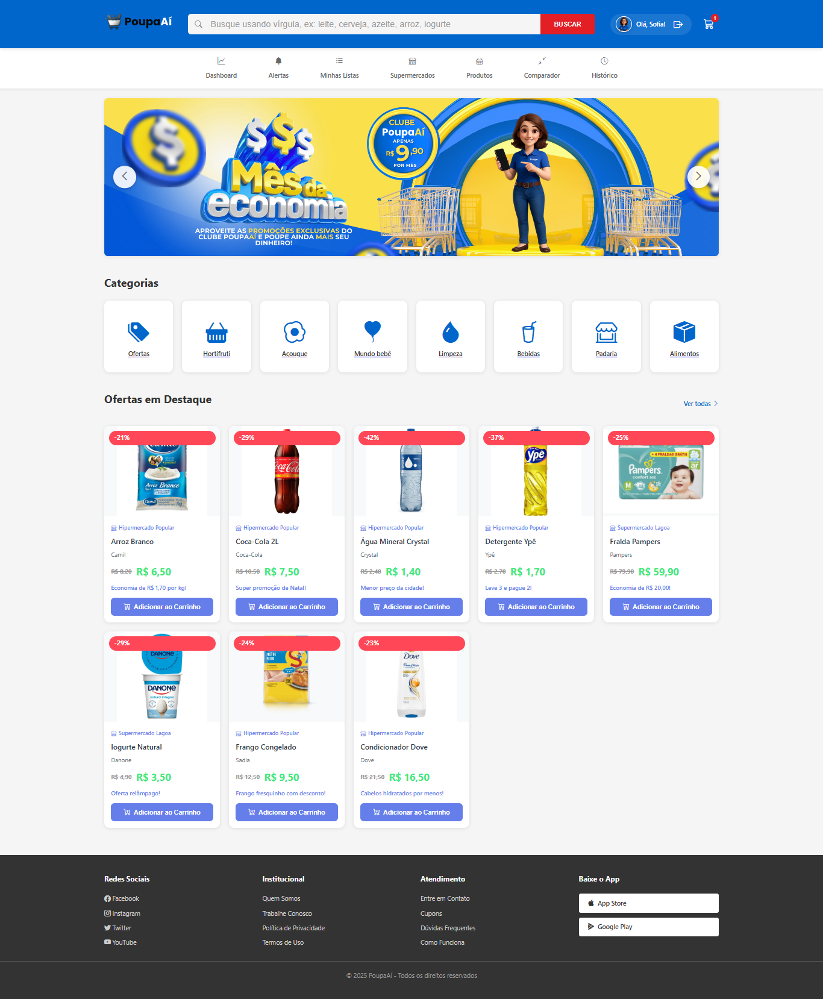

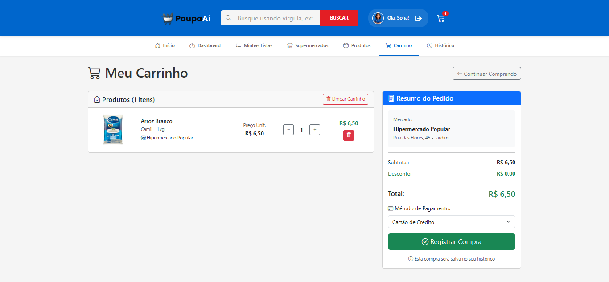

- **Estrutura de dados:**

Produtos

```json
    {
      "id": 1,
      "nome": "Arroz Branco",
      "marca": "Camil",
      "categoria": "Alimentos",
      "unidade_medida": "kg",
      "tamanho_embalagem": "1",
      "descricao": "Arroz branco tipo 1, grãos selecionados",
      "imagem_url": "/codigo/public/assets/img/arroz_branco_camil_1kg.jpg",
      "criadoEm": "2024-01-01T10:00:00",
      "atualizadoEm": "2025-01-28T10:00:00",
      "ocorrencias": [
        {
          "mercadoId": 1,
          "preco": 7.2,
          "precoAnterior": 7.9,
          "estoque": "Em estoque",
          "ultimaAtualizacao": "2025-01-28T10:00:00"
        }
      ]
    }
```

##### Funcionalidade 3 - Visualizar, ver detalhes, avaliar e ver mercados no mapa

Permite que o usuário veja os mercados disponíveis, veja seus detalhes, avalie e veja o mercado no mapa

- **Instruções de acesso:**
  - Na barra de navegação, vá em "Supermercados"
  - Clique nos detalhes do supermercado desejado
  - Se desejar, clique em "Adicionar Avaliação"
  - Salve a sua avaliação
  - Voltando em supermercados, clique em "Ver Mapa"
- **Tela da funcionalidade**:

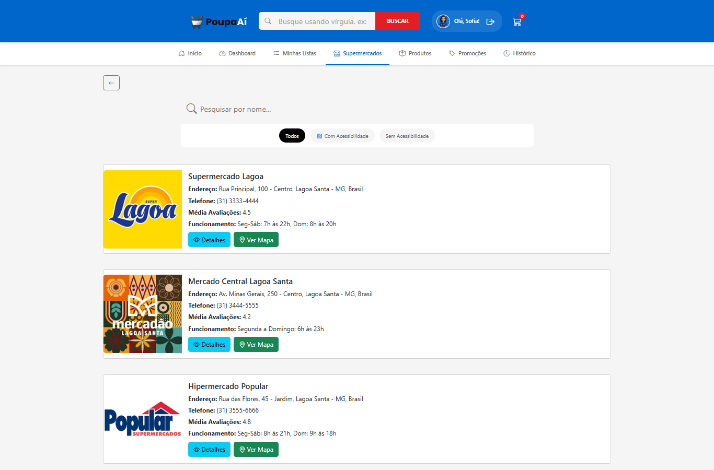

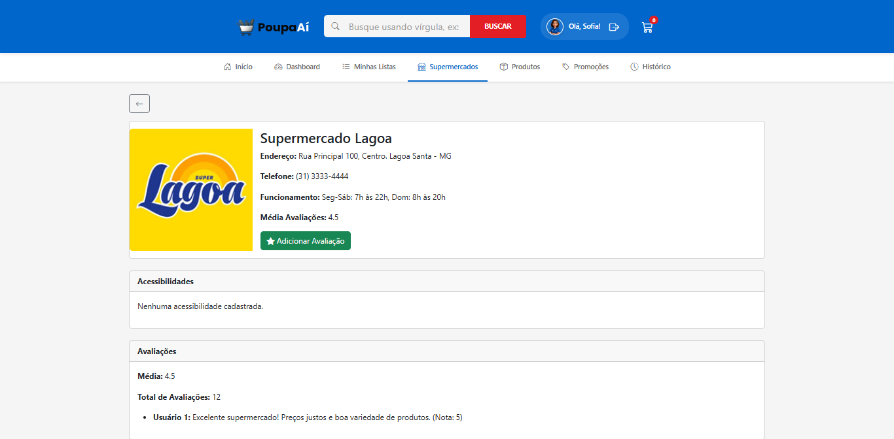

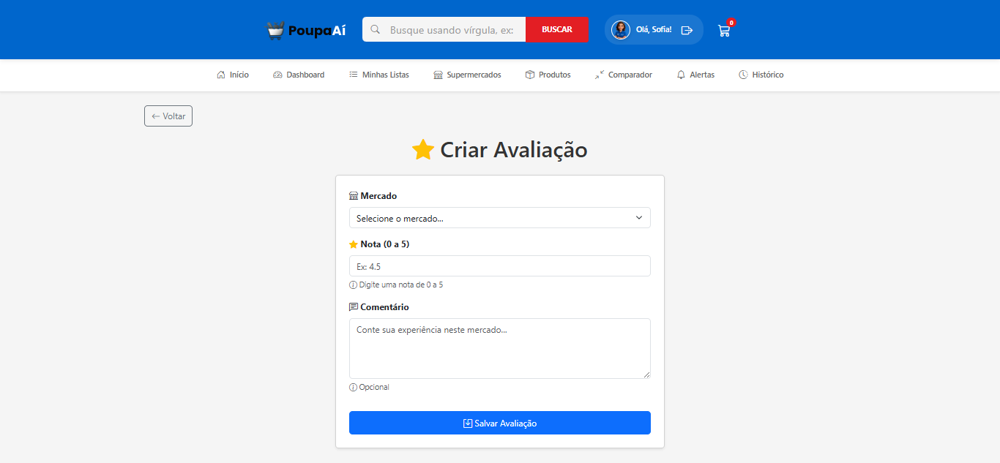

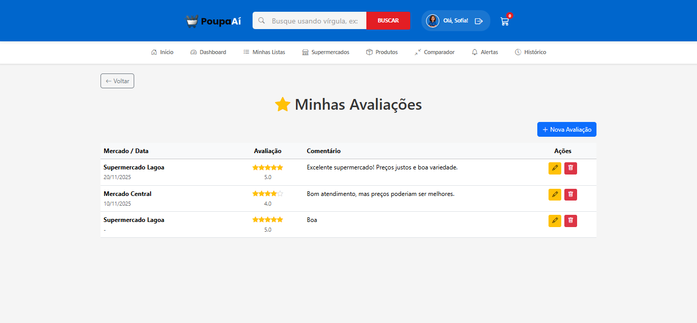

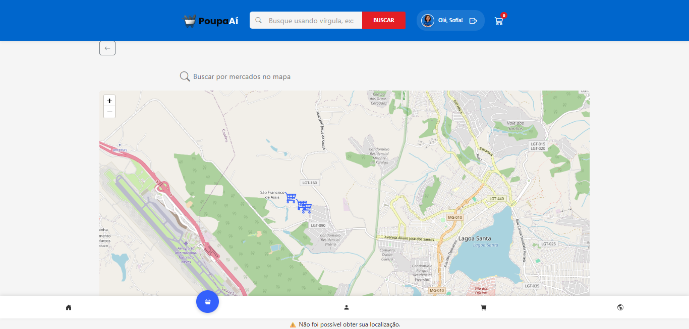

- **Estrutura de dados:**

Mercados

```json
    {
      "id": 1,
      "nome": "Supermercado Lagoa",
      "logo": "/codigo/public/assets/img/logo_super_lagoa.png",
      "endereco": {
        "cep": "33400-000",
        "rua": "Rua Principal",
        "numero": "100",
        "bairro": "Centro",
        "cidade": "Lagoa Santa",
        "estado": "MG",
        "pais": "Brasil"
      },
      "telefone": "(31) 3333-4444",
      "email": "contato@superlagoa.com.br",
      "horarioFuncionamento": "Seg-Sáb: 7h às 22h, Dom: 8h às 20h",
      "localizacao": {
        "latitude": -19.6305,
        "longitude": -43.936
      },
      "acessibilidade": {
        "rampa": null,
        "elevador": null,
        "vagas": null,
        "piso": true,
        "braille": true,
        "preferencial": true,
        "libras": null
      },
      "votos": {
        "rampa": { "likes": 0, "dislikes": 0 },
        "elevador": { "likes": 0, "dislikes": 0 },
        "vagas": { "likes": 0, "dislikes": 0 },
        "piso": { "likes": 5, "dislikes": 0 },
        "braille": { "likes": 3, "dislikes": 0 },
        "preferencial": { "likes": 8, "dislikes": 0 },
        "libras": { "likes": 0, "dislikes": 0 }
      },
      "mediaAvaliacoes": 4.5,
      "numeroDeAvaliacoes": 12,
      "dataAtualizacao": "2025-01-28T10:30:00"
    }
```
Acessibilidade

```json
    {
      "id": 1,
      "tipo": "Rampa de acesso"
    },
    {
      "id": 2,
      "tipo": "Elevador"
    },
    {
      "id": 3,
      "tipo": "Vagas preferenciais"
    },
    {
      "id": 4,
      "tipo": "Piso tátil"
    },
    {
      "id": 5,
      "tipo": "Sinalização em Braille"
    },
    {
      "id": 6,
      "tipo": "Atendimento em Libras"
    },
    {
      "id": 7,
      "tipo": "Caixa preferencial"
    }
```
Avaliações

```json
    {
      "id": 1,
      "usuarioId": 1,
      "mercadoId": 1,
      "nota": 5,
      "comentario": "Excelente supermercado! Preços justos e boa variedade.",
      "data": "2025-11-20T16:00:00"
    }
```

##### Funcionalidade 4 - Buscar, filtrar, visualizar, ver detalhes, cadastrar e excluir produtos

Permite Que o usuário busque, filtre, veja o produto e seus detalhes. Ao administrador, permite cadastrar e excluir produtos

- **Instruções de acesso:**
  - Na barra de navegação, vá em "Produtos"
  - Se desejar, na barra de pesquisa busque por um produto específico
  - Também é possível ir em "Por Categoria" para filtragem
  - No produto desejado, clique em detalhes
  - Se o administrador desejar cadastrar um novo produto, clique em "Cadastrar Produto"
  - Em produtos, se o administrador desejar excluir um produto, clique em "excluir"
- **Tela da funcionalidade**:


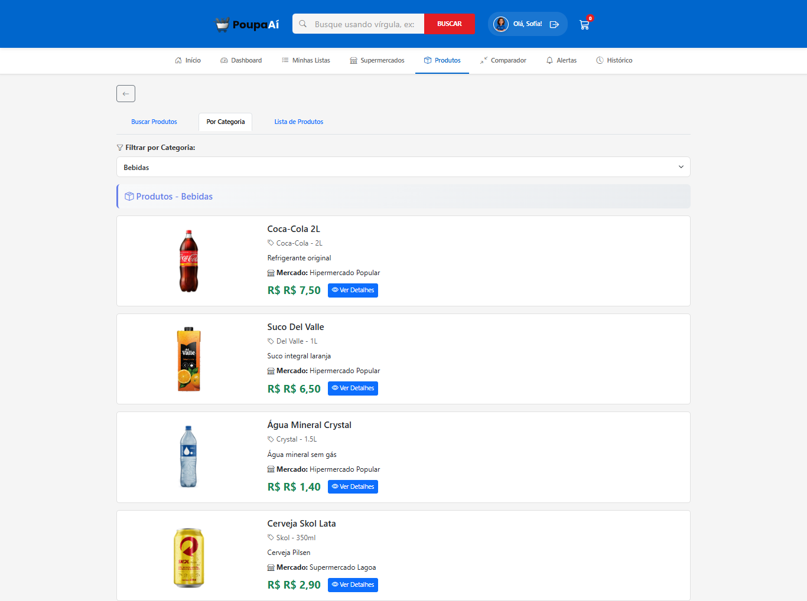

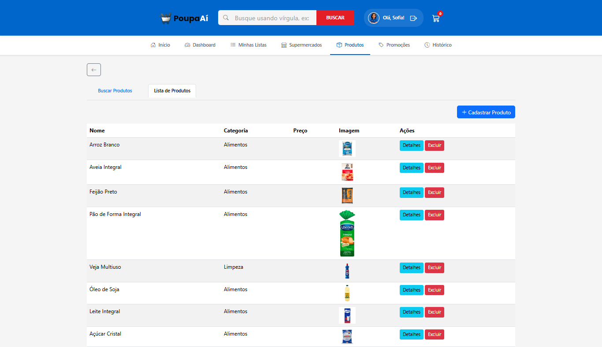

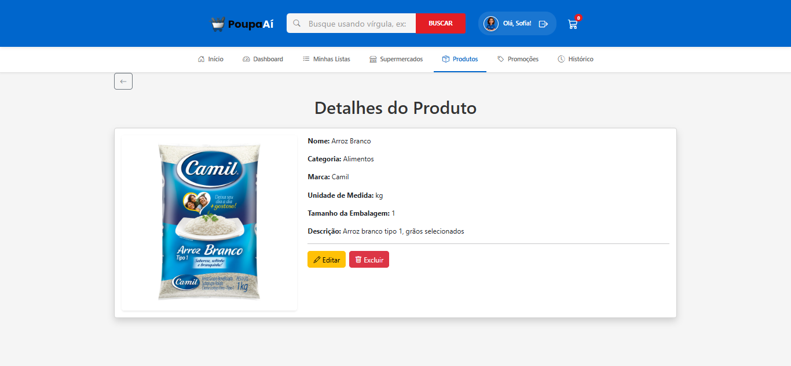

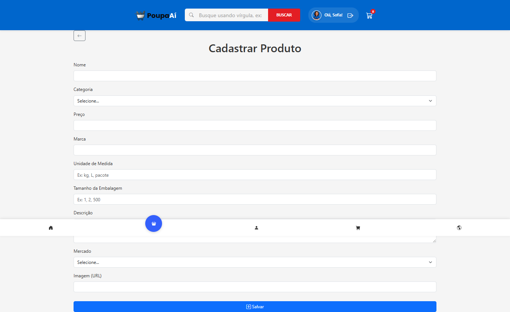

- **Estrutura de dados:**

Produtos

```json
    {
      "id": 1,
      "nome": "Arroz Branco",
      "marca": "Camil",
      "categoria": "Alimentos",
      "unidade_medida": "kg",
      "tamanho_embalagem": "1",
      "descricao": "Arroz branco tipo 1, grãos selecionados",
      "imagem_url": "/codigo/public/assets/img/arroz_branco_camil_1kg.jpg",
      "criadoEm": "2024-01-01T10:00:00",
      "atualizadoEm": "2025-01-28T10:00:00",
      "ocorrencias": [
        {
          "mercadoId": 1,
          "preco": 7.2,
          "precoAnterior": 7.9,
          "estoque": "Em estoque",
          "ultimaAtualizacao": "2025-01-28T10:00:00"
        }
      ]
    }
```

Categorias

```json
    {
      "id": 1,
      "nome": "Alimentos",
      "icone": "bi-basket",
      "descricao": "Produtos alimentícios em geral"
    },
    {
      "id": 2,
      "nome": "Limpeza",
      "icone": "bi-droplet",
      "descricao": "Produtos de limpeza e higiene do lar"
    }
```

##### Funcionalidade 5 - Visualizar, criar, editar e excluir listas de compras

Permite Que o usuário veja, crie, edite e exclua suas listas de compras

- **Instruções de acesso:**
  - Na barra de navegação, vá em "Minhas Listas"
  - Clique em "Nova Lista"
  - Após já ter alguma lista, clique em "Editar", caso deseje editar a lista pronta
  - Se não queira mais ter alguma lista de compras, clique em "excluir" na lista desejada
- **Tela da funcionalidade**:

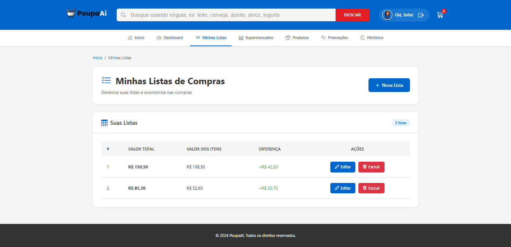

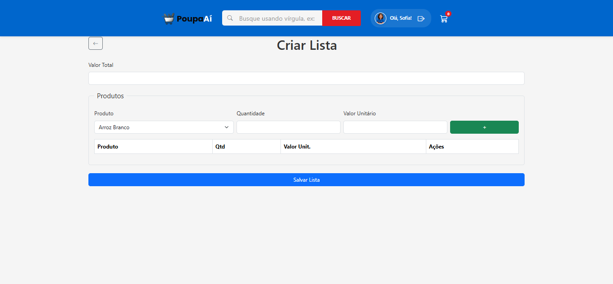

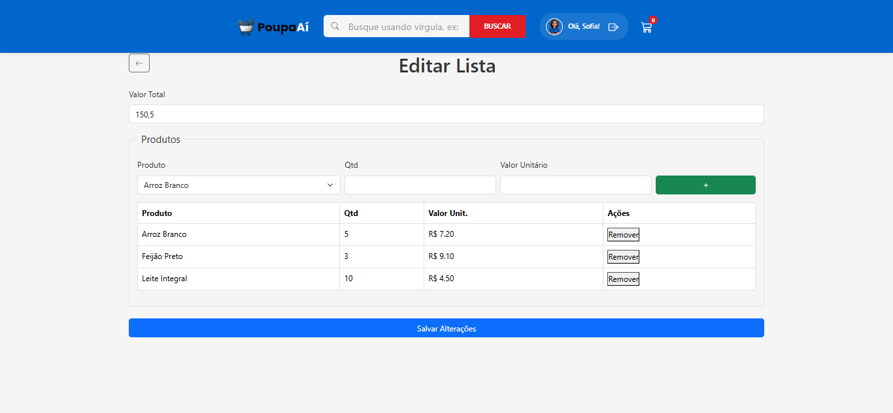

- **Estrutura de dados:**

Listas

```json
    {
      "id": 1,
      "usuarioId": 1,
      "nome": "Lista Mensal - Janeiro",
      "dataCriacao": "2025-01-15T10:00:00",
      "dataAtualizacao": "2025-01-28T14:30:00",
      "status": "ativa",
      "valor": 150.5,
      "produtos": [
        {
          "produtoId": 1,
          "quantidade": 5,
          "valorUnitario": 7.2,
          "mercadoId": 1
        },
        {
          "produtoId": 3,
          "quantidade": 3,
          "valorUnitario": 9.1,
          "mercadoId": 1
        },
        {
          "produtoId": 7,
          "quantidade": 10,
          "valorUnitario": 4.5,
          "mercadoId": 1
        }
      ]
    }
```

##### Funcionalidade 6 - Comparador de preços

Permite que o usuário compare preços tanto de produtos específicos quanto preços de listas

- **Instruções de acesso:**
  - Na barra de navegação, vá em "Comparador"
  - Em "Buscar Produto", digite o nome do produto que se deseja visualizar e comparar preços
  - Se desejar comparar listas, clique em "Comparar lista", digite o nome da lista
- **Tela da funcionalidade**:

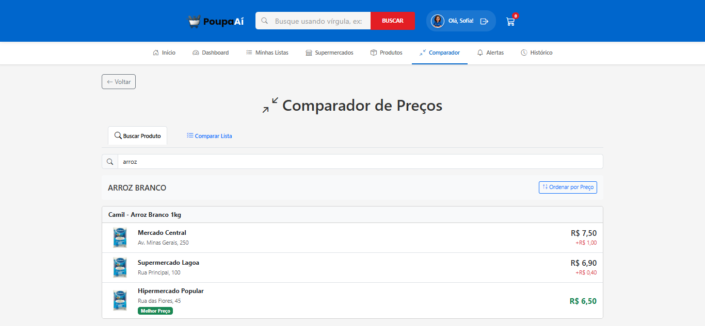
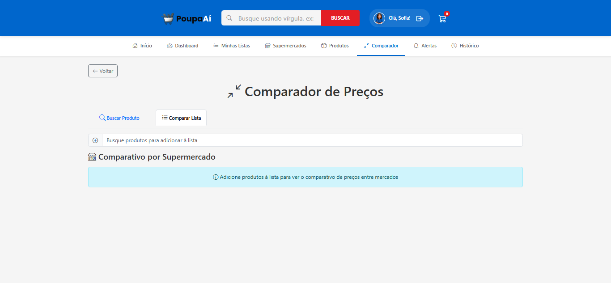

- **Estrutura de dados:**

Produtos

```json
    {
      "id": 1,
      "nome": "Arroz Branco",
      "marca": "Camil",
      "categoria": "Alimentos",
      "unidade_medida": "kg",
      "tamanho_embalagem": "1",
      "descricao": "Arroz branco tipo 1, grãos selecionados",
      "imagem_url": "/codigo/public/assets/img/arroz_branco_camil_1kg.jpg",
      "criadoEm": "2024-01-01T10:00:00",
      "atualizadoEm": "2025-01-28T10:00:00",
      "ocorrencias": [
        {
          "mercadoId": 1,
          "preco": 7.2,
          "precoAnterior": 7.9,
          "estoque": "Em estoque",
          "ultimaAtualizacao": "2025-01-28T10:00:00"
        }
      ]
    }
```

Listas

```json
    {
      "id": 1,
      "usuarioId": 1,
      "nome": "Lista Mensal - Janeiro",
      "dataCriacao": "2025-01-15T10:00:00",
      "dataAtualizacao": "2025-01-28T14:30:00",
      "status": "ativa",
      "valor": 150.5,
      "produtos": [
        {
          "produtoId": 1,
          "quantidade": 5,
          "valorUnitario": 7.2,
          "mercadoId": 1
        },
        {
          "produtoId": 3,
          "quantidade": 3,
          "valorUnitario": 9.1,
          "mercadoId": 1
        },
        {
          "produtoId": 7,
          "quantidade": 10,
          "valorUnitario": 4.5,
          "mercadoId": 1
        }
      ]
    }
```

##### Funcionalidade 7 - Alertas

Permite que o usuário receba/veja alertas de preço abaixando, e crie novos alertas de produtos que desejar

- **Instruções de acesso:**
  - Na barra de navegação, vá em "Alertas"
  - Agora se é possível ver os alertas já criados (ativos e lidos)
  - Se desejar alterar algum alerta, clique em "Gerenciar Alertas"
  - Também, se desejar, é possível criar um novo alerta, clicando em "Novo Alerta"

- **Tela da funcionalidade**:

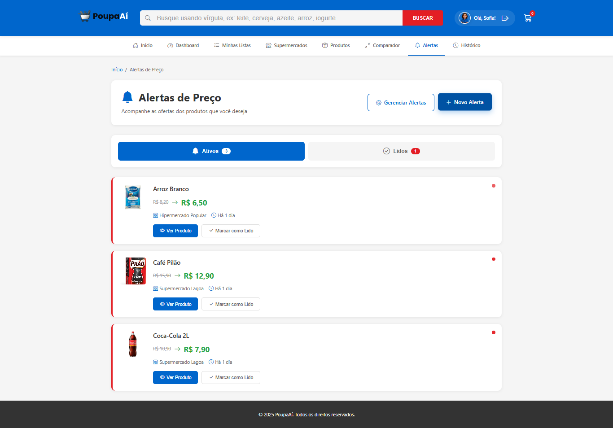
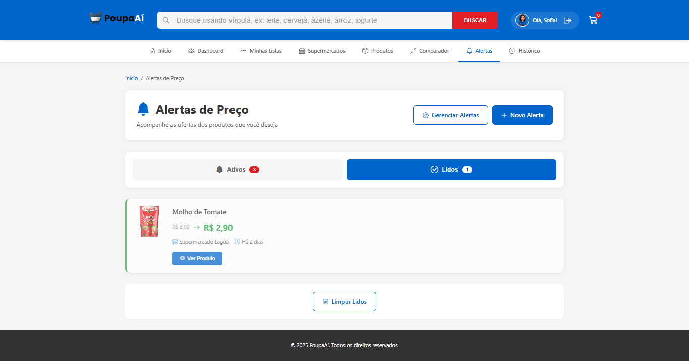
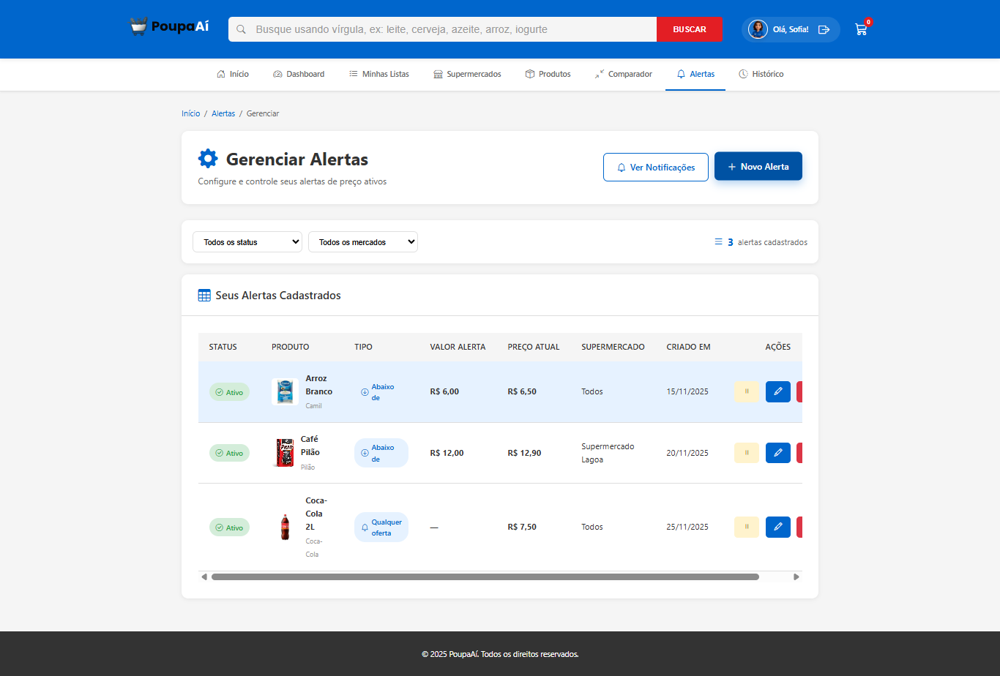
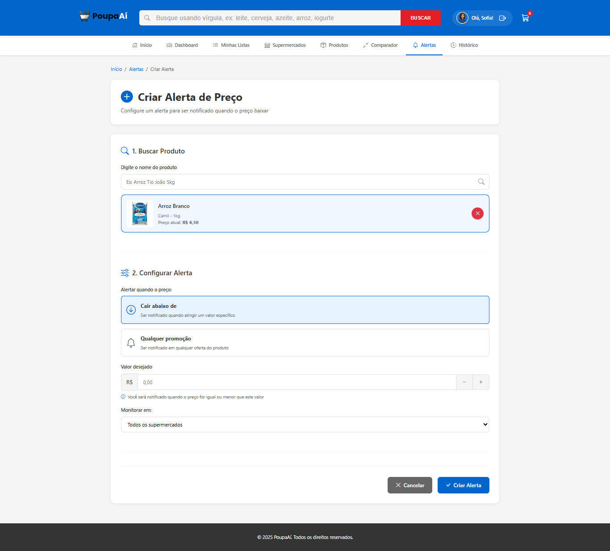

- **Estrutura de dados:**

AlertasConfig

```json
    {
      "id": 1,
      "usuarioId": 1,
      "produtoId": 1,
      "mercadoId": null,
      "tipo": "abaixo",
      "valorAlerta": 6,
      "ativo": true,
      "dataCriacao": "2025-11-15T10:00:00"
    }
```

Alertas

```json
    {
      "id": 1,
      "usuarioId": 1,
      "produtoId": 1,
      "mercadoId": 3,
      "tipo": "abaixo",
      "valorAlerta": 6,
      "precoAnterior": 8.2,
      "precoNovo": 6.5,
      "dataNotificacao": "2025-12-08T08:15:00",
      "lido": false
    }
```

##### Funcionalidade 8 - Visualizar, e excluir hisórico de compras

Permite que o usuário veja seu histórico de compras e exclua alguma compra do histórico

- **Instruções de acesso:**
  - Na barra de navegação, vá em "Histórico"
  - Após visualizar seu histórico de compras, se desejar excluir alguma compra, clique em "excluir" na compra desejada
- **Tela da funcionalidade**:

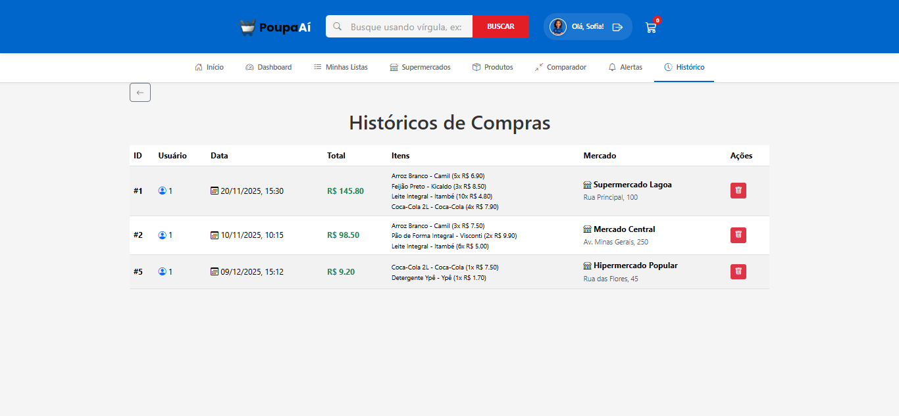

- **Estrutura de dados:**

Histórico de compras

```json
    {
      "id": 1,
      "usuarioId": 1,
      "mercadoId": 1,
      "data": "2025-01-20T15:30:00",
      "status": "Finalizado",
      "total": 62.48,
      "metodoPagamento": "Cartão de Crédito",
      "itens": [
        {
          "produtoId": 1,
          "quantidade": 2,
          "precoUnitario": 7.2,
          "subtotal": 14.4
        },
        {
          "produtoId": 3,
          "quantidade": 2,
          "precoUnitario": 9.1,
          "subtotal": 18.2
        },
        {
          "produtoId": 7,
          "quantidade": 4,
          "precoUnitario": 4.5,
          "subtotal": 18.0
        },
        {
          "produtoId": 5,
          "quantidade": 2,
          "precoUnitario": 6.7,
          "subtotal": 13.4
        }
      ]
    }
```

## Módulos e APIs

Esta seção apresenta os módulos e APIs utilizados na solução

| Propósito   | Plataforma      | Link                                                               |
| :---------- | :-------------- | :----------------------------------------------------------------- |
| **Scripts** | jQuery          | [http://www.jquery.com/](http://www.jquery.com/)     |
| **Scripts** | Bootstrap 5     | [http://getbootstrap.com/](http://getbootstrap.com/) |
| **Imagens** | Google Imagens     | [https://images.google.com/?hl=pt-br](https://images.google.com/?hl=pt-br) |

# Referências

As referências utilizadas no trabalho foram:

- NEGÓCIOS SC. *Entenda o impacto dos preços nas compras de supermercado*. Florianópolis, 01 out. 2024. Disponível em: <https://www.negociossc.com.br/blog/entenda-o-impacto-dos-precos-nas-compras-de-supermercado/>. Acesso em: 08 dez. 2025.

- ASSOCIAÇÃO PAULISTA DE SUPERMERCADOS – APAS. *71% dos brasileiros mudaram seus hábitos de compra em um ano, aponta APAS*. São Paulo, 06 jun. 2025. Disponível em: <https://apas.com.br/71-dos-brasileiros-mudaram-seus-habitos-de-compra-em-um-ano-aponta-apas/>. Acesso em: 08 dez. 2025.

- CHALEGRA, Jessica. *Consumidor brasileiro: entre preços e comportamentos no supermercado*. Consumidor Moderno, 07 mar. 2024. Disponível em: <https://consumidormoderno.com.br/consumidor-brasileiro-supermercado/>. Acesso em: 08 dez. 2025.

- INSTITUTO BRASILEIRO DE GEOGRAFIA E ESTATÍSTICA – IBGE. *POF 2024-2025 – Pesquisa de Orçamentos Familiares*. Disponível em: <https://www.ibge.gov.br/pof2024/>. Acesso em: 08 dez. 2025.

- NEOGRID; OPINION BOX. *Hábitos de compra no varejo alimentar*. jun. 2024. Disponível em: <https://hub.neogrid.com/hubfs/neogrid_opinion-box_relatorio_habitos-de-compra-varejo-alimentar_2024_v3.pdf?hsLang=en>. Acesso em: 08 dez. 2025.

- SCANNTECH. *Perfil de consumo nos supermercados brasileiros muda em 2025*. São Paulo, 21 maio 2025. Disponível em: <https://www.scanntech.com.br/perfil-consumo-supermercados-2025-2/>. Acesso em: 08 dez. 2025.

- EM TEMPO. *Serasa: 59% das dívidas de cartão de crédito são de compras em supermercados*. 13 nov. 2023. Disponível em: <https://emtempo.com.br/191618/economia/serasa-59-das-dividas-de-cartao-de-credito-sao-de-compras-em-supermercados/>. Acesso em: 08 dez. 2025.

- GB NEWS. *Pesquisa inédita revela hábito de compra dos consumidores*. 23 nov. 2020. Disponível em: <https://www.gbnews.com.br/single-post/2020/11/23/pesquisa-in%C3%A9dita-revela-h%C3%A1bito-de-compra-consumidores>. Acesso em: 08 dez. 2025.

- NEOGRID. *Brasileiros gastaram 19,7% a mais nos supermercados em 2023, aponta levantamento exclusivo da Neogrid*. 26 fev. 2024. Disponível em: <https://www.neogrid.com/noticias/panorama-bens-de-consumo/>. Acesso em: 08 dez. 2025.

- ASSERJ – ASSOCIAÇÃO DE SUPERMERCADOS DO ESTADO DO RIO DE JANEIRO. *Consumo em supermercados supera 15% de crescimento em 2023, aponta pesquisa*. 23 jan. 2024. Disponível em: <https://asserj.com.br/pt/w/consumo-em-supermercados-superam-15-de-crescimento-em-2023-aponta-pesquisa>. Acesso em: 08 dez. 2025.

- MOTA, Gabriel da. *59% das dívidas de brasileiros no cartão de crédito são com supermercado, diz Serasa*. O Liberal, 02 jan. 2024. Disponível em: <https://www.oliberal.com/economia/59-dos-brasileiros-se-endividam-no-cartao-de-credito-com-supermercado-diz-serasa-1.763079>. Acesso em: 08 dez. 2025.

- GRUPO REPÓRTER. *Consumo em supermercados no Brasil cresce 4% em julho de 2025*. 22 ago. 2025. Disponível em: <https://gruporeporter.com.br/consumo-em-supermercados-no-brasil-cresce-4-em-julho-de-2025/>. Acesso em: 08 dez. 2025.

- CNN BRASIL. *Supermercados faturam R$ 1 tri em 2024, equivalente a 9% do PIB, diz Abras*. 15 abr. 2025. Disponível em: <https://www.cnnbrasil.com.br/economia/negocios/supermercados-faturam-r-1-tri-em-2024-equivalente-a-9-do-pib-diz-abras/>. Acesso em: 08 dez. 2025.
