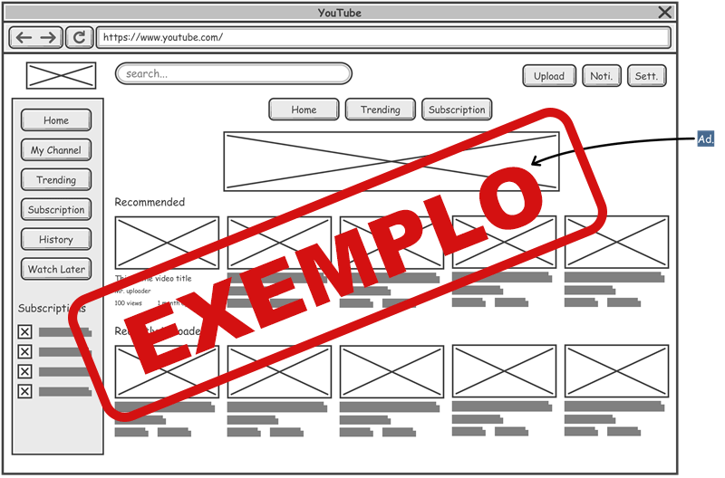

# Introdução

Informações básicas do projeto.

- **Projeto:** PoupaAí
- **Repositório GitHub:** https://github.com/ICEI-PUC-Minas-PPLES-TI/plf-es-2025-2-ti1-5567100-precos_mercado.git
- **Membros da equipe:**

  - [Bernardo Duarte Medeiros de Paula](https://github.com/bernardodvarte)
  - [Bruna Pedrosa Nunes](https://github.com/brunapedrosabr)
  - [Lucas Gonçalves Sivolella](https://github.com/lsivolella)
  - [Plínio Ângelo Ferreira](https://github.com/afplinio)
  - [Sofia Ferreira Costa](https://github.com/costa-sofia)
  - [Vinicius Ramos Sales](https://github.com/ViniRSales)

A documentação do projeto é estruturada da seguinte forma:

1. Introdução
2. [Contexto](#contexto)
3. [Product Discovery](#product-discovery)
4. [Product Design](#product-design)
5. [Metodologia](#metodologia)
6. [Solução](#solução-implementada)
7. [Referências Bibliográficas](#referências)

✅ [Documentação de Design Thinking (MIRO)](files/Design%20Thinking.pdf)

# Contexto

Detalhes sobre o espaço de problema, os objetivos do projeto, sua justificativa e público-alvo.

## Problema

O cenário atual de compras em supermercados no Brasil apresenta alguns desafios para os consumidores como:

**1. Falta de centralização da Informações**

- Os consumidores precisam consumir múltiplas fontes de informação para comparar preços como sites dos supermercados, aplicativos, folhetos promocionais dos supermercados e/ou anúncios.
- As informações sobre promoções são dispersas e difíceis de encontrar.
- Não é mantido um histórico de compras para o consumidor poder replicar e/ou consultar a fim de otimizar suas compras.

**2. Ineficiência no Planejamento**

- Segundo pesquisa feita pela Neogrid e Opinion Box de 2024, 40% dos brasileiros fazem múltiplicas compras no mês o que pode estar ligado por falta de planejamento ou por preferência do consumidor em dividir por partes.
- As listas de compras são regularmente esquecidas ou incompletas pelos consumidores.
- Não há sugestão ao consumidor baseado em consumo anterior.

**3. Perda de Oportunidade Econômica**

- Segundo pesquisa feita pela Neogrid e Opinion Box de 2024, 85% dos brasileiros compram além do planejado quando encontram produtos com preços mais baixos.
- As promoções são frequentemente descobertas no momento da compra.
- Há carência e falta de alertas personalizados sobre ofertas relevantes para o consumidor específico.

Esse problema se manifesta em um mercado onde 90% dos brasileiros buscam constantemente economia, mas carecem de ferramentas tecnológicas integradas para otimizar suas decisões de compra.

## Objetivos

**Objetivo Geral:** Desenvolver uma aplicação mobile que centralize e otimize a experiência de compras em supermercado, oferecendo comparação de preços, gestão inteligente de listas, alertas personalizados de ofertas e promoções além da visualização no mapa de locais com melhores preços para consumidores brasileiros.

**Objetivos Específicos:**

- Implementar um sistema de comparação de preços
- Criar funcionalidade da gestão inteligente da lista de compras podendo salvar, criar ou editar
- Estabelecer sistema de alertas personalizados para promoções relevantes baseadas nas preferências do usuário

## Justificativa

O desenvolvimento dessa aplicação web se baseia principalmente em três tópicos que são:

**1. Relevância Econômica**

- 47% das despesas familiares brasileiras são com alimentação.
- O setor de supermercados representa 13,6% da receita do comércio nacional.
- 90% dos consumidores buscam constantemente opções mais baratas no quesito supermercado.
- O setor de supermercados é um setor em crescimento com 4% de alta no consumo em 2025.
- A aplicação pode gerar economia significativa para as famílias brasileiros visto que, segundo o Serasa, as compras de supermercado são a principal fonte de endividamente no cartão de crédito dos brasileiros.

**2. Oportunidade Tecnológica**

- 71% dos brasileiros mudaram hábitos de compra no últino ano.
- 30% dos brasileiros pesquisam preços antes de ir ao supermercado.
- 85% dos brasileiros compram além do planejado quando encontram ofertas.
- Há falta de soluções integradas no mercado brasileiro.

**3. Experiência do Consumidor**

- Consumidores buscam praticidade, saúde e escolhas conscientes.

## Público-Alvo

**✳️✳️✳️ COLOQUE AQUI O SEU TEXTO ✳️✳️✳️**

> ⚠️ **APAGUE ESSA PARTE ANTES DE ENTREGAR SEU TRABALHO**
>
> Descreva quais são as pessoas que usarão a sua aplicação indicando os diferentes perfis. A ideia é, dentro do possível, conhecer um pouco mais sobre o perfil dos usuários: conhecimentos prévios, relação com a tecnologia, relações hierárquicas, etc.
>
> Adicione informações sobre o público-alvo por meio de uma descrição textual, ou diagramas de personas, mapa de stakeholders, ou como o grupo achar mais conveniente.
>
> **Orientações**:
>
> - [Público-alvo: o que é, tipos, como definir seu público e exemplos](https://klickpages.com.br/blog/publico-alvo-o-que-e/)
> - [Qual a diferença entre público-alvo e persona?](https://rockcontent.com/blog/diferenca-publico-alvo-e-persona/)

# Product Discovery

## Etapa de Entendimento

### Matriz CSD


### Mapa de Stakeholders


### Entrevistas Qualitativas


### Highlights de Pesquisa


## Etapa de Definição

### Personas

Persona 1: Osvaldo


Persona 2: Pedro


Persona 3: Carla


# Product Design

Nesse momento, vamos transformar os insights e validações obtidos em soluções tangíveis e utilizáveis. Essa fase envolve a definição de uma proposta de valor, detalhando a prioridade de cada ideia e a consequente criação de wireframes, mockups e protótipos de alta fidelidade, que detalham a interface e a experiência do usuário.

## Histórias de Usuários

Com base na análise das personas foram identificadas as seguintes histórias de usuários:

| ID   | EU COMO...`PERSONA`                | QUERO/PRECISO ...`FUNCIONALIDADE`                                           | PARA ...`MOTIVO/VALOR`                                                                   |
| ---- | ---------------------------------- | --------------------------------------------------------------------------- | ---------------------------------------------------------------------------------------- |
| US01 | Osvaldo                            | Um histórico com os preços dos produtos que costumo consumir                | Evitar lojas que tenham aumentado os preços repentinamente e buscar produtos substitutos |
| US02 | Pedro                              | Encontrar os melhores preços para os produtos                               | Ter mais dinheiro para sair com os amigos                                                |
| US03 | Carla                              | Saber onde posso encontrar os produtos que preciso comprar                  | Ter mais tempo para realizar minhas tarefas e descansar em casa                          |
| US04 | Consumidor geral                   | Um aplicativo que me ajude a descobrir o preço dos produtos de supermercado | Que eu possa comparar preços e assim economizar em minhas compras                        |
| US05 | Dono de restaurante                | Saber o local onde encontro todos produtos que preciso                      | Comprar os ingredientes necessários para cozinhar todos os alimentos do cardápio         |
| US06 | Membro de uma grande família       | Comprar uma grande quantidade de itens no supermercado                      | Atender toda a demanda familiar e manter a qualidade do lar                              |
| US07 | Atleta                             | Encontrar produtos específicos com facilidade                               | Atender minha dieta restrita                                                             |
| US08 | Consumidor com mobilidade reduzida | Consumidor com mobilidade reduzida                                          | Que eu consiga fazer minhas compras sem maiores complicações                             |
| US09 | Empresária                         | Otimizar meu tempo com idas as supermercado                                 | Conciliar meu trabalho com as compras de casa para mim e para minha família              |

## Proposta de Valor

##### Proposta para Persona 1: Osvaldo


##### Proposta para Persona 2: Pedro


##### Proposta para Persona 3: Carla


## Projeto de Interface

Artefatos relacionados com a interface e a interacão do usuário na proposta de solução.

### Wireframes

Estes são os protótipos de telas do sistema.

**✳️✳️✳️ COLOQUE AQUI OS PROTÓTIPOS DE TELAS COM TÍTULO E DESCRIÇÃO ✳️✳️✳️**

##### TELA XPTO ⚠️ EXEMPLO ⚠️

Descrição para a tela XPTO



> ⚠️ **APAGUE ESSA PARTE ANTES DE ENTREGAR SEU TRABALHO**
>
> Wireframes são protótipos das telas da aplicação usados em design de interface para sugerir a estrutura de um site web e seu relacionamentos entre suas páginas. Um wireframe web é uma ilustração semelhante ao layout de elementos fundamentais na interface.
>
> **Orientações**:
>
> - [Ferramentas de Wireframes](https://rockcontent.com/blog/wireframes/)
> - [Figma](https://www.figma.com/)
> - [Adobe XD](https://www.adobe.com/br/products/xd.html#scroll)
> - [MarvelApp](https://marvelapp.com/developers/documentation/tutorials/)

### User Flow

**✳️✳️✳️ COLOQUE AQUI O DIAGRAMA DE FLUXO DE TELAS ✳️✳️✳️**


> ⚠️ **APAGUE ESSA PARTE ANTES DE ENTREGAR SEU TRABALHO**
>
> Fluxo de usuário (User Flow) é uma técnica que permite ao desenvolvedor mapear todo fluxo de telas do site ou app. Essa técnica funciona para alinhar os caminhos e as possíveis ações que o usuário pode fazer junto com os membros de sua equipe.
>
> **Orientações**:
>
> - [User Flow: O Quê É e Como Fazer?](https://medium.com/7bits/fluxo-de-usu%C3%A1rio-user-flow-o-que-%C3%A9-como-fazer-79d965872534)
> - [User Flow vs Site Maps](http://designr.com.br/sitemap-e-user-flow-quais-as-diferencas-e-quando-usar-cada-um/)
> - [Top 25 User Flow Tools &amp; Templates for Smooth](https://www.mockplus.com/blog/post/user-flow-tools)

### Protótipo Interativo

**✳️✳️✳️ COLOQUE AQUI UM IFRAME COM SEU PROTÓTIPO INTERATIVO ✳️✳️✳️**

✅ [Protótipo Interativo (MarvelApp)](https://marvelapp.com/prototype/4hd6091?emb=1&iosapp=false&frameless=false) ⚠️ EXEMPLO ⚠️

> ⚠️ **APAGUE ESSA PARTE ANTES DE ENTREGAR SEU TRABALHO**
>
> Um protótipo interativo apresenta o projeto de interfaces e permite ao usuário navegar pelas funcionalidades como se estivesse lidando com o software pronto. Utilize as mesmas ferramentas de construção de wireframes para montagem do seu protótipo interativo. Inclua o link para o protótipo interativo do projeto.

# Metodologia

Detalhes sobre a organização do grupo e o ferramental empregado.

## Ferramentas

Relação de ferramentas empregadas pelo grupo durante o projeto.

| Ambiente                    | Plataforma         | Link de acesso                                                                                               |
| --------------------------- | ------------------ | ------------------------------------------------------------------------------------------------------------ |
| Processo de Design Thinking | Miro               | https://miro.com/app/board/uXjVJRfmPqM=/                                                                     |
| Comunicação                 | Google Meet        | https://meet.google.com/                                                                                     |
| Repositório de código       | GitHub             | https://github.com/ICEI-PUC-Minas-PPLES-TI/plf-es-2025-2-ti1-5567100-precos_mercado.git                      |
| Editor de código            | Visual Studio Code | https://code.visualstudio.com/                                                                               |
| Protótipo Interativo        | Figma              | https://www.figma.com/design/LlSi6oktUlezQnomFvF1KN/Pre%C3%A7os-Mercado?node-id=0-1&p=f&t=DBwjVbY4Q0JGavk3-0 |

## Gerenciamento do Projeto

Divisão de papéis no grupo e apresentação da estrutura da ferramenta de controle de tarefas (Kanban).


> ⚠️ **APAGUE ESSA PARTE ANTES DE ENTREGAR SEU TRABALHO**
>
> Nesta parte do documento, você deve apresentar o processo de trabalho baseado nas metodologias ágeis, a divisão de papéis e tarefas, as ferramentas empregadas e como foi realizada a gestão de configuração do projeto via GitHub.
>
> Coloque detalhes sobre o processo de Design Thinking e a implementação do Framework Scrum seguido pelo grupo. O grupo poderá fazer uso de ferramentas on-line para acompanhar o andamento do projeto, a execução das tarefas e o status de desenvolvimento da solução.
>
> **Orientações**:
>
> - [Sobre Projects - GitHub Docs](https://docs.github.com/pt/issues/planning-and-tracking-with-projects/learning-about-projects/about-projects)
> - [Gestão de projetos com GitHub | balta.io](https://balta.io/blog/gestao-de-projetos-com-github)
> - [(460) GitHub Projects - YouTube](https://www.youtube.com/playlist?list=PLiO7XHcmTsldZR93nkTFmmWbCEVF_8F5H)
> - [11 Passos Essenciais para Implantar Scrum no seu Projeto](https://mindmaster.com.br/scrum-11-passos/)
> - [Scrum em 9 minutos](https://www.youtube.com/watch?v=XfvQWnRgxG0)

# Solução Implementada

Esta seção apresenta todos os detalhes da solução criada no projeto.

## Vídeo do Projeto

O vídeo a seguir traz uma apresentação do problema que a equipe está tratando e a proposta de solução. ⚠️ EXEMPLO ⚠️

[](https://www.youtube.com/embed/70gGoFyGeqQ)

> ⚠️ **APAGUE ESSA PARTE ANTES DE ENTREGAR SEU TRABALHO**
>
> O video de apresentação é voltado para que o público externo possa conhecer a solução. O formato é livre, sendo importante que seja apresentado o problema e a solução numa linguagem descomplicada e direta.
>
> Inclua um link para o vídeo do projeto.

## Funcionalidades

Esta seção apresenta as funcionalidades da solução.Info

##### Funcionalidade 1 - Cadastro de Contatos ⚠️ EXEMPLO ⚠️

Permite a inclusão, leitura, alteração e exclusão de contatos para o sistema

- **Instruções de acesso:**
  - Abra o site e efetue o login
  - Acesse o menu principal e escolha a opção Cadastros
  - Em seguida, escolha a opção Contatos
- **Tela da funcionalidade**:


- **Estrutura de dados:** ⚠️ EXEMPLO ⚠️

Contatos da aplicação

```json
{
  "id": 1,
  "nome": "Leanne Graham",
  "cidade": "Belo Horizonte",
  "categoria": "amigos",
  "email": "Sincere@april.biz",
  "telefone": "1-770-736-8031",
  "website": "hildegard.org"
}
```

> ⚠️ **APAGUE ESSA PARTE ANTES DE ENTREGAR SEU TRABALHO**
>
> Apresente cada uma das funcionalidades que a aplicação fornece tanto para os usuários quanto aos administradores da solução.
>
> Inclua, para cada funcionalidade, itens como: (1) titulos e descrição da funcionalidade; (2) Estrutura de dados associada; (3) o detalhe sobre as instruções de acesso e uso.

## Módulos e APIs

Esta seção apresenta os módulos e APIs utilizados na solução

| Propósito   | Plataforma      | Link                                                               |
| :---------- | :-------------- | :----------------------------------------------------------------- |
| **Images**  | Unsplash        | [https://unsplash.com/](https://unsplash.com/) ⚠️ EXEMPLO ⚠️       |
| **Fonts**   | Icons Font Face | [https://fontawesome.com/](https://fontawesome.com/) ⚠️ EXEMPLO ⚠️ |
| **Scripts** | jQuery          | [http://www.jquery.com/](http://www.jquery.com/) ⚠️ EXEMPLO ⚠️     |
| **Scripts** | Bootstrap 4     | [http://getbootstrap.com/](http://getbootstrap.com/) ⚠️ EXEMPLO ⚠️ |

> ⚠️ **APAGUE ESSA PARTE ANTES DE ENTREGAR SEU TRABALHO**
>
> Apresente os módulos e APIs utilizados no desenvolvimento da solução. Inclua itens como: (1) Frameworks, bibliotecas, módulos, etc. utilizados no desenvolvimento da solução; (2) APIs utilizadas para acesso a dados, serviços, etc.

# Referências

As referências utilizadas no trabalho foram:

- SOBRENOME, Nome do autor. Título da obra. 8. ed. Cidade: Editora, 2000. 287 p ⚠️ EXEMPLO ⚠️

> ⚠️ **APAGUE ESSA PARTE ANTES DE ENTREGAR SEU TRABALHO**
>
> Inclua todas as referências (livros, artigos, sites, etc) utilizados no desenvolvimento do trabalho.
>
> **Orientações**:
>
> - [Formato ABNT](https://www.normastecnicas.com/abnt/trabalhos-academicos/referencias/)
> - [Referências Bibliográficas da ABNT](https://comunidade.rockcontent.com/referencia-bibliografica-abnt/)
